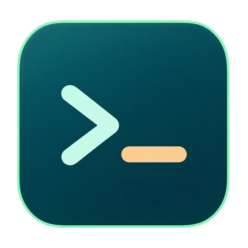

# JuiAI Terminal

JuiAI Terminal is a native Windows desktop app for working with AI models and agents. Connect a model you already run, or add an API provider, then use the same window to chat, manage workspace memory, test speech and vision models, and review tool requests.

## Install on Windows

1. Download **JuiAI-Terminal** for Windows x64 from the [latest release](https://github.com/Juibell/JuiAI-Terminal/releases/latest). Choose the Windows release ZIP under **Assets**.
2. Extract the entire ZIP to a writable folder. Keep the launcher, router and desktop app together.
3. Double-click **`JuiAI-Terminal.exe`** in the extracted folder. On first launch, setup prepares Python 3.12 and installs the locked router dependencies. Allow internet access for this step. The ZIP includes the compiled WinUI 3 app and its .NET runtime. To see startup messages in a terminal, run `JuiAI-Terminal.cmd`.

## Connect your first model

1. Open **Models and connections → Provider connections → Add connection**. Choose the protocol, enter the endpoint URL and supply an API key if your provider requires one. For a local OpenAI-compatible server, use its loopback URL with the API base path, for example `http://127.0.0.1:1234/v1`.
2. Under **Model profile**, choose **Add model profile**. Select the connection, enter the model ID or use **List models**, then select the capabilities the model supports.
3. Under **Model assignments**, choose the profile as the **Main model** and select **Save model assignments**.
4. Open **Chat** and send a message. To test one capability in isolation, select **Test model** on its profile.

## What you can do

| Area | Use it to |
| --- | --- |
| Chat and history | Start conversations, revisit earlier messages and work with attachments. |
| Models and connections | Manage providers and assign separate models for chat, reasoning, vision or speech. |
| Workspace and memory | Select a working folder and maintain the memories available to that workspace. |
| Agents and tools | Inspect agent status and review tool requests. Optional agent integrations use separately installed runtimes. |
| Search and voice | Configure a search service, test endpoints, transcribe audio and compare speech samples. |
| Audio processing | Run vocal isolation or stem separation when the corresponding local tools and models are available. |

Model weights, agent engines and optional audio tools are separate installations. A configured text provider is sufficient for chat. The desktop app communicates with a loopback service. Provider keys saved through the app use Windows Data Protection for the current user. Local settings, history and credentials created after installation belong to that copy of the app.

## Build from source

Install the x64 .NET 10 SDK specified in [global.json](15_Control-Center/global.json), then run the following commands from the repository root in PowerShell.

```powershell
powershell -NoProfile -ExecutionPolicy Bypass -File .\Build-ControlCenter.ps1
.\JuiAI-Terminal.cmd
```

The [WinUI client](15_Control-Center/) contains the desktop views, service client and client checks. The [Python router](05_Agent-Router/) contains the local API, provider adapters, workspace storage, tests and locked dependencies.
