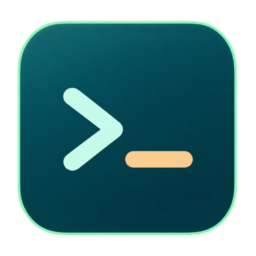

# JuiAI Terminal

[English](README.md) · **简体中文**

JuiAI Terminal 是一个 Windows 原生桌面控制台。你可以连接自己运行的模型或 API 服务，在同一个窗口里聊天、管理工作区记忆、测试语音和视觉模型，以及审批智能体的工具请求。

## 在 Windows 上安装

1. 打开[最新发布页](https://github.com/Juibell/JuiAI-Terminal/releases/latest)，在 **Assets** 下下载文件名以 **`windows-x64.zip`** 结尾的压缩包。
2. 将整个 ZIP 解压到有写入权限的文件夹，启动器、路由服务和桌面程序需要保持解压后的目录结构。
3. 双击解压目录最外层的 **`JuiAI-Terminal.exe`**。首次启动需要联网准备 Python 3.12，并安装锁文件指定的依赖。压缩包已经包含 WinUI 3 桌面程序及其 .NET 运行时。如果需要查看命令行中的启动信息，可以运行 `JuiAI-Terminal.cmd`。

## 切换界面语言

首次启动默认显示英文。打开 **Settings and diagnostics → Display language**，选择 **简体中文**。如需切回英文，打开 **设置与诊断 → 显示语言**，选择 **English**。下次启动会沿用你的选择。

## 连接第一个模型

1. 打开 **模型与连接 → 服务商连接 → 添加连接**。选择协议并填写服务地址。如果服务商要求密钥，再填写 API 密钥。本机的 OpenAI 兼容服务可以填写包含 API 路径的回环地址，例如 `http://127.0.0.1:1234/v1`。
2. 在 **模型档案** 中选择 **添加模型档案**。选中刚才添加的连接，填写服务端使用的模型 ID，或读取服务端的模型列表。勾选模型实际支持的能力。
3. 在 **用途绑定** 中，将该档案选为 **主脑**，点击 **保存用途绑定**。
4. 打开对话页面，发送第一条消息。你也可以从模型档案进入独立调试，单独验证文字、图像或语音能力。

## 可以用它做什么

| 功能 | 用途 |
| --- | --- |
| 对话与历史记录 | 开始新对话、查看早先的消息、使用附件。 |
| 模型与连接 | 管理服务商连接，为聊天、推理、视觉和语音分配不同的模型。 |
| 工作区与记忆 | 选择工作目录，管理该工作区可以使用的记忆。 |
| 智能体与工具 | 查看智能体状态并审批工具请求。可选智能体需要单独安装运行环境。 |
| 搜索与语音 | 配置搜索服务、测试连接、转写录音、对比语音样本。 |
| 声音处理 | 装好相应的本地工具和模型后，可提取人声或分离音轨。 |

连接一个支持文字的模型就可以开始聊天。模型权重、智能体引擎和可选音频工具按需安装。桌面程序通过本机回环地址访问路由服务。在界面中保存的服务商密钥由 Windows 数据保护机制按当前用户加密。每份安装各自保存设置、历史记录和凭据。

## 从源码构建

安装 [global.json](https://github.com/Juibell/JuiAI-Terminal/blob/main/15_Control-Center/global.json) 指定的 x64 .NET 10 SDK，在仓库根目录打开 PowerShell，然后运行以下命令。

```powershell
powershell -NoProfile -ExecutionPolicy Bypass -File .\Build-ControlCenter.ps1
.\JuiAI-Terminal.cmd
```

[WinUI 客户端](https://github.com/Juibell/JuiAI-Terminal/tree/main/15_Control-Center) 包含桌面界面、服务客户端和客户端检查。[Python 路由服务](https://github.com/Juibell/JuiAI-Terminal/tree/main/05_Agent-Router) 包含本机 API、服务商适配器、工作区存储、测试和依赖锁文件。
